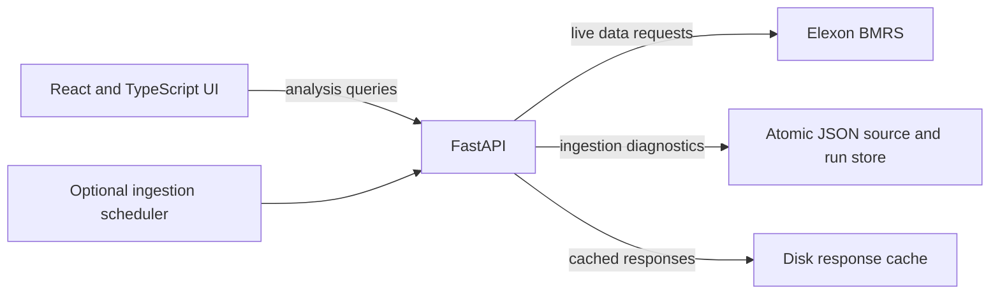

# WindSight UK

**Day-Ahead Wind Generation Forecast Monitoring and Accuracy Evaluation**

WindSight UK is a decision-support application for monitoring what wind
generation forecast was available at a historical procurement decision time
and evaluating it against Elexon BMRS actual wind generation. It is not an
electricity trading platform and does not provide prices, savings estimates, or
trading recommendations.

## Business problem

UK procurement teams need a reproducible view of day-ahead forecast
information as it existed at the time of a purchasing decision, alongside
actual wind generation and a transparent measure of historical forecast error.
Using a forecast published after the decision would introduce look-ahead bias.
WindSight preserves publication times and selects forecasts using a configurable
decision cutoff so later revisions cannot leak into earlier decisions.

## Features

- Responsive dashboard with overview, forecast explorer, accuracy analysis,
  historical analysis, and methodology/data-quality pages.
- Forecast Revision Timeline for inspecting every retrieved WINDFOR revision
  for a selected delivery interval, including post-decision revisions.
- Historical Backtesting Lab for comparing configurable Europe/London decision
  cutoffs on a common set of matched delivery intervals.
- Persistence-baseline benchmarking using only forecasts published by the
  historical cutoff, plus empirical residual what-if scenarios.
- Pipeline diagnostics for retrieval attempts, successful refreshes, malformed
  and missing records, source timestamps, failed requests, and cache use.
- Optional scheduled, incremental Elexon ingestion with idempotent file-backed
  source retention and a token-protected manual sync endpoint.
- Explicit separation between live Elexon analysis requests and the independent
  persisted ingestion archive used by pipeline diagnostics.
- Rolling API availability and response-time metrics (mean and p95).
- Live Elexon BMRS ingestion: FUELHH actuals filtered to `fuelType=WIND` and
  WINDFOR forecast revisions, with source metadata and timestamps retained.
- Point-in-time selection, explicit missing-data states, and duplicate conflict
  flags.
- Backend-computed MAE, RMSE, mean bias error, WAPE, maximum absolute error,
  matched counts, independent availability counts, and coverage.
- Configurable Europe/London decision cutoff and date range limited to January
  2026 decision dates.
- Async HTTPX client, bounded retries/concurrency, configurable disk cache,
  typed FastAPI responses, and browser API proxy for local development.

## Architecture

```text
React + TypeScript + Vite
  └─ TanStack Query → typed Axios API client → /api
                                            └─ FastAPI
                                                ├─ Elexon BMRS HTTPX client
                                                ├─ disk response cache
                                                ├─ scheduled incremental ingestion
                                                ├─ atomic file-backed source/run store
                                                ├─ normalization and validation
                                                ├─ point-in-time selection
                                                └─ metrics and typed API schemas

Docker Compose (optional)
  ├─ Nginx static frontend and same-origin /api reverse proxy
  └─ FastAPI backend with health check
```

The backend is organized under `backend/app/{api,clients,core,models,schemas,services}`.
The Vite application is under `frontend/src/{components,hooks,pages,services,types,utils}`.



## Technology stack

- **Frontend:** React, TypeScript, Vite, Tailwind CSS 4, React Router, Recharts,
  TanStack Query, Axios, Lucide React.
- **Backend:** Python 3.11+, FastAPI, Pydantic Settings, HTTPX, Uvicorn, pytest.
- **Containers:** Docker Compose, multi-stage Node/Nginx frontend, Python slim
  backend image.
- **Data:** Elexon BMRS only; no application database, weather service,
  electricity-market price source, demand forecast, or machine-learning model.

## Data sources and scope

WindSight uses only these Elexon BMRS datasets:

- [FUELHH stream documentation — actuals](https://bmrs.elexon.co.uk/api-documentation/endpoint/datasets/FUELHH/stream)
- [WINDFOR stream documentation — forecasts](https://bmrs.elexon.co.uk/api-documentation/endpoint/datasets/WINDFOR/stream)
- API base URL: `https://data.elexon.co.uk/bmrs/api/v1`

The decision period is **January 1–31, 2026 inclusive**. A decision date and
delivery date are different: each decision date is evaluated against the
following local calendar day. Thus January 31 decisions require February 1
delivery data. The service creates the expected half-hour delivery intervals
with Europe/London timezone rules, including DST-aware day lengths.

FUELHH is filtered to `WIND`; its documentation describes average MW over
30-minute intervals. WINDFOR forecast records retain `startTime`, `publishTime`,
`generation`, and available source metadata. The inspected WINDFOR documentation
does not establish that its generation values use measurement/averaging
semantics equivalent to FUELHH. Observed WINDFOR target times are hourly while
FUELHH targets are half-hourly. Comparisons therefore use exact UTC target-time
matches only and must be treated as **indicative** until Elexon confirms source
equivalence.

## Historical forecast selection

For each January decision date:

1. Compute the configured local decision cutoff in `Europe/London`, then
   normalize it to UTC.
2. Derive the next local calendar day as the delivery date and generate that
   date's expected 30-minute target intervals.
3. For each target interval, retain only forecast records whose normalized
   `publishTime` is less than or equal to the decision cutoff.
4. Select the eligible record with the greatest publication timestamp. If
   records at that timestamp conflict, choose a stable deterministic value and
   flag the conflicting duplicate in the response.
5. Match the selected forecast and WIND actual using the exact normalized UTC
   target timestamp. Missing forecasts or actuals remain missing, not zero.

The default cutoff is **12:00 Europe/London**. This is a configurable analysis
assumption, not a claim about exchange gate closure. Set
`WINDSIGHT_DECISION_CUTOFF_LOCAL_TIME` to another local clock time, such as
`11:30:00`, when an agreed procurement decision time is available.

The WINDFOR publication retrieval lookback defaults to 31 days before the
earliest requested decision date and is configurable. This is an application
request-window setting, not a documented Elexon retention guarantee; forecasts
published earlier than that lookback are not included.

## Backtesting, benchmarking, and what-if analysis

`GET /api/backtest` accepts the January decision date range and two distinct
`HH:MM` cutoff values in `Europe/London`. Forecasts are retrieved through the
later cutoff, then reconstructed separately at each historical cutoff; no
publication after a selected cutoff is eligible. The response includes
individual cutoff metrics and a separate comparison scored on the exact common
matched timestamps where both forecasts and the actual are present.

The persistence benchmark for each delivery interval is the forecast for the
immediately preceding 30-minute target interval that had been published by that
same decision cutoff. The first interval of a delivery day has no in-day
predecessor. Missing predecessor forecasts remain missing; baseline metrics
and Elexon benchmark metrics are scored on the same shared matched subset and
report its count; baseline values are not forward-filled.

The Backtesting Lab also exposes empirical p10/p50/p90 forecast-error
quantiles. Its What-if panel applies those historical residual quantiles to a
user-entered reference generation level and labels all outcomes hypothetical.
These are not calibrated prediction intervals, actual forecasts, purchase
recommendations, or trading advice.

## Operational monitoring

`GET /api/data-quality` reports the most recent pipeline operation, attempt
and successful-refresh timestamps, source record counts, missing and malformed
records, latest retrieved source timestamps, and Elexon request/cache counters.
Analysis endpoints currently fetch their data directly from Elexon; the JSON
ingestion archive is independent and is not an analytics source of truth.
`GET /api/performance` reports rolling five-minute request count, server-error
availability, mean and p95 API response time, plus process uptime and lifetime
counts. The rolling sample is bounded to 10,000 requests. These operational
metrics are in-memory and process-local; they reset on restart and are intended
for this single-process portfolio deployment, not as durable distributed
monitoring.

## Automated ingestion and validation

The backend can run a lightweight asyncio scheduler in the application process;
no external queue is required. `WINDSIGHT_INGESTION_ENABLED` controls whether
the background loop runs (disabled by default for local development and enabled
by default in Docker Compose). It performs an initial sync on startup and then
waits `WINDSIGHT_INGESTION_INTERVAL_SECONDS` before the next run. Elexon
timeouts, HTTP 429, and HTTP 5xx responses use the existing bounded exponential
backoff/retry policy. A failed run is recorded and surfaced in pipeline
diagnostics; the next scheduled run retries without advancing the publication
checkpoint.

Actuals are re-read for the latest configured delivery-date lookback so source
corrections can be picked up. Forecast ingestion resumes from the last
successful publication checkpoint with a configurable overlap to capture late
revisions. Every raw source record in the retrieved window is retained;
identical source records are idempotently ignored while distinct revisions and
conflicting values at the same target/publication time are preserved. The
checkpoint advances only after both source datasets are fetched, validated, and
persisted successfully.

The store is a versioned JSON document written atomically to
`WINDSIGHT_INGESTION_STORE_PATH`. It contains source records, rejected-record
details, the last 100 run summaries, and the incremental checkpoint. Docker
Compose mounts a named volume at `/data` so the store survives container
recreation. The existing Elexon disk response cache remains in place and
reduces repeated requests. This simple store is suitable for the current
single-process portfolio workload; it is not a substitute for a multi-worker
database, and concurrent backend replicas must not share it.

Validation applies the existing strict required-field, timezone-aware timestamp,
finite numeric generation, and WIND-fuel checks. Rejected raw records and their
validation reason are retained for inspection. Exact repeated source records
are counted as duplicates; conflicting values at the same forecast target and
publication timestamp or actual target are separately counted and retained.
Forecast target timestamps not aligned to a half-hour boundary are reported as
off-grid; this is a warning, not a reason to fabricate or coerce values.
Missing actual delivery intervals are counted against DST-aware expected
half-hour intervals for completed delivery dates in the synchronized window;
the in-progress local delivery day is excluded to avoid treating not-yet-
published actuals as missing. The source currently
publishes forecast targets that may be hourly, so no half-hour interpolation
or unsupported forecast-coverage assumption is introduced. Missing intervals
are data availability indicators and do not, by themselves, mean ingestion
failed.

Configure the pipeline with the `WINDSIGHT_INGESTION_*` variables documented
in the environment-variable table below.

Manual sync is exposed as `POST /api/admin/ingestion/sync` and requires the
`X-Admin-Token` header. The endpoint returns HTTP 503 when no admin token is
configured and HTTP 401 when the supplied token is invalid. For example:

```powershell
Invoke-RestMethod -Method Post `
  -Uri http://localhost:8000/api/admin/ingestion/sync `
  -Headers @{ "X-Admin-Token" = $env:WINDSIGHT_INGESTION_ADMIN_TOKEN }
```

This token protects the manual ingestion action; it is not user authentication.
Do not expose the backend administrative endpoint publicly without TLS and
secret management. Scheduled ingestion does not require the admin token.

## Forecast Revision Timeline

The Forecast Explorer includes a selectable delivery-interval timeline that
plots the retained WINDFOR `generation` values against their original
`publishTime` timestamps. The vertical marker shows the configured
`Europe/London` decision cutoff. Every normalized source record in the retrieval
window remains visible, including repeated publication timestamps; conflicting
duplicate values are identified rather than silently overwritten. Revisions
sharing a publication timestamp are ordered by generation value so their
timeline order does not depend on the order returned by Elexon.

For the historical procurement decision, WindSight selects the record with the
latest publication timestamp at or before the cutoff. A publication exactly at
the cutoff is eligible. Later revisions are clearly labeled post-decision and
are not used for the historical selection. They were not available when that
decision was made, so including them in its selected forecast would introduce
look-ahead bias.

`GET /api/forecast-revisions` takes a `decision_date` and timezone-aware
`target_time`. The target must be a 30-minute interval on the following local
delivery date. The endpoint applies the configured cutoff and publication
lookback and retrieves matching revisions through the current retrieval time;
no missing publication is synthesized.

> **Screenshot placeholder:** Add a Forecast Explorer capture here after a
> representative live timeline is selected.

## Accuracy formulas

Only observations with both a selected forecast and an actual value are used
for error statistics. For each matched interval:

```text
error_mw = forecast_mw - actual_mw
MAE      = mean(abs(error_mw))
RMSE     = sqrt(mean(error_mw ** 2))
Bias     = mean(error_mw)       # positive = overestimation
WAPE     = sum(abs(error_mw)) / sum(abs(actual_mw)) * 100
```

WAPE is `null` when the sum of absolute matched actual values is zero. The API
also returns maximum absolute error, expected/matched counts, missing forecasts
and actuals, and separate forecast and actual coverage. Empty metric sets are
returned as null metrics, not invented values. No MAPE, arbitrary normalized
accuracy score, missing-value substitution, interpolation, or MWh conversion
is performed. Power readings are expressed in MW.

## Local setup

Prerequisites: Node.js 20.19+ or 22.12+, Python 3.11+, and network access to the
Elexon API. PowerShell commands below are for Windows; adapt directory changes
for other shells.

### Backend

```powershell
cd backend
python -m venv .venv
.\.venv\Scripts\Activate.ps1
python -m pip install -r requirements.txt
Copy-Item .env.example .env
python -m uvicorn app.main:app --reload
```

Backend health: <http://localhost:8000/api/health>  
Interactive API documentation: <http://localhost:8000/docs>

### Frontend

In a second terminal:

```powershell
cd frontend
npm ci
Copy-Item .env.example .env.local
npm run dev
```

Frontend: <http://localhost:5173>. Vite proxies `/api` requests to
`http://localhost:8000` by default. `VITE_API_PROXY_TARGET` changes the dev
proxy target. `VITE_API_BASE_URL` sets the browser API base URL; use `/api` with
the same-origin proxy in local and Nginx deployments.

## Environment variables

Backend variables use the `WINDSIGHT_` prefix. Defaults are available in
`backend/.env.example`.

| Variable | Default | Purpose |
|---|---|---|
| `WINDSIGHT_APP_NAME` | `WindSight UK API` | FastAPI application title. |
| `WINDSIGHT_FRONTEND_ORIGINS` | `http://localhost:5173,http://localhost:8080` | Comma-separated CORS origins allowed by FastAPI. |
| `WINDSIGHT_ELEXON_API_BASE_URL` | `https://data.elexon.co.uk/bmrs/api/v1` | Elexon BMRS API base. |
| `WINDSIGHT_ELEXON_TIMEOUT_SECONDS` | `30` | Per-request HTTP timeout (must be greater than 0 and at most 300). |
| `WINDSIGHT_ELEXON_MAX_RETRIES` | `3` | Retry count for timeouts, transport errors, HTTP 429, and HTTP 5xx. |
| `WINDSIGHT_CACHE_DIR` | `.cache/elexon` | On-disk Elexon response cache location. |
| `WINDSIGHT_CACHE_TTL_SECONDS` | `900` | Cache lifetime; `0` disables cache reads and writes. |
| `WINDSIGHT_CACHE_REFRESH` | `false` | Bypass cache reads to force source refresh. |
| `WINDSIGHT_INGESTION_ENABLED` | `false` | Enable the background ingestion loop; Docker Compose defaults it to `true`. |
| `WINDSIGHT_INGESTION_INTERVAL_SECONDS` | `3600` | Sync interval in seconds (60–86400). |
| `WINDSIGHT_INGESTION_LOOKBACK_DAYS` | `2` | Inclusive actual-data lookback and initial forecast lookback (1–90). |
| `WINDSIGHT_INGESTION_FORECAST_OVERLAP_HOURS` | `6` | Forecast publication overlap to capture late revisions (1–168). |
| `WINDSIGHT_INGESTION_STORE_PATH` | `.data/windsight/ingestion.json` | Persistent JSON source and run-history store. |
| `WINDSIGHT_INGESTION_ADMIN_TOKEN` | unset | Protects `POST /api/admin/ingestion/sync`; never commit this secret. |
| `WINDSIGHT_DECISION_CUTOFF_LOCAL_TIME` | `12:00:00` | Decision clock time in `Europe/London`. |
| `WINDSIGHT_FORECAST_PUBLICATION_LOOKBACK_DAYS` | `31` | WINDFOR publication lookback (allowed range 1–90 days). |

Frontend variables are in `frontend/.env.example`:

| Variable | Default | Purpose |
|---|---|---|
| `VITE_API_BASE_URL` | `/api` | Browser request base path. |
| `VITE_API_PROXY_TARGET` | `http://localhost:8000` | Vite development-server proxy target. |

Do not put secrets in `VITE_*` variables: Vite embeds them in client assets.
This application currently requires no Elexon API credential.

## API endpoints

All endpoints use the `/api` prefix. Analysis decision-date ranges are
inclusive and restricted to January 2026; query validation errors return HTTP
422. Elexon request failures are surfaced as HTTP 502.

| Endpoint | Query parameters | Purpose |
|---|---|---|
| `GET /api/health` | None | Liveness response with service status. |
| `GET /api/overview` | `decision_start`, `decision_end` (optional; default full January) | Selected period KPIs and daily history. |
| `GET /api/forecasts` | Required aware `publish_from`, `publish_to` timestamps | Normalized WINDFOR source records for a publication window. |
| `GET /api/forecast-revisions` | Required `decision_date` and timezone-aware `target_time` | All matching WINDFOR revisions in the configured window, cutoff eligibility, and selected decision revision. |
| `GET /api/actuals` | Required inclusive `start_date`, `end_date` delivery dates | Normalized FUELHH WIND actual records. |
| `GET /api/comparison` | `decision_start`, `decision_end`; optional `decision_date` inside the range | Interval observations, decision/delivery dates, cutoff, forecast age, availability, conflict flags, and provenance. |
| `GET /api/accuracy` | `decision_start`, `decision_end`; optional `decision_date` inside the range | Overall, by-decision-date, and by-delivery-date metrics. |
| `GET /api/history` | `decision_start`, `decision_end` | Daily accuracy and coverage trend by decision date. |
| `GET /api/data-quality` | None | Source and pipeline status, persisted record/run counts, validation/duplicate/missing counts, source timestamps, request and cache counters. |
| `POST /api/admin/ingestion/sync` | `X-Admin-Token` header | Trigger an incremental source sync when an admin token is configured. |

For full schemas and query descriptions, see FastAPI OpenAPI at
<http://localhost:8000/docs> while the backend is running.

## Tests and QA

```powershell
cd frontend
npm run typecheck
npm run lint
npm run build

cd ..\backend
python -m pytest
```

The backend tests use mocked Elexon responses and cover normalization,
publication cutoffs, duplicate handling, metrics, missing data, DST, January
boundaries, incremental ingestion, persistence/idempotency, failed-run recovery,
and protected manual synchronization. The latest executed test report is in
[docs/TEST-REPORT.md](./docs/TEST-REPORT.md). Docker has not been built or
started in this environment; see the report for verification limits.

## Docker

From the repository root, with Docker Engine/Desktop and Compose v2 installed:

```powershell
docker compose up --build
```

The Nginx frontend is at <http://localhost:8080>; backend health is at
<http://localhost:8000/api/health>. Nginx proxies browser `/api/` calls to the
backend container. Stop the stack with:

```powershell
docker compose down
```

These instructions describe the configured deployment. Docker is not available
in the current audit environment, so image building, container health, and
container routing are **not verified here**.

## Deployment instructions and verified URLs

No public host or production deployment is configured. Do not treat any public
URL as available or verified. Verified during local development/audit:

- Frontend: <http://localhost:5173/overview> (Vite development server).
- Backend health: <http://localhost:8000/api/health>.
- Backend OpenAPI: <http://localhost:8000/docs>.
- Docker/Nginx addresses `<http://localhost:8080>` and
  `<http://localhost:8000/api/health>` are configured but not verified because
  Docker is unavailable.

For a future public deployment, deploy the backend container to a supported
Python/container host and the frontend to a static host (for example, Vercel).
Set the frontend build variable `VITE_API_BASE_URL` to the deployed backend
`/api` URL, and set `WINDSIGHT_FRONTEND_ORIGINS` on the backend to the exact
frontend origin. Configure both services' health/build settings and verify the
public frontend, API health, CORS, and analytics responses before reporting a
deployment as successful. No hosting account, credentials, or public URL are
included in this project.

## Known limitations

- WINDFOR and FUELHH measurement/aggregation equivalence is not established by
  the inspected endpoint documentation; resulting metrics are indicative.
- Hourly forecast targets versus half-hourly actual targets mean exact matching
  can yield missing forecast coverage. No interpolation or forward-fill is
  applied.
- Forecast retrieval uses a configurable 31-day default publication lookback
  (maximum 90 days), not an asserted source retention period.
- Revision timeline history is limited by that configured publication lookback
  and the Elexon records returned for the request; source retention/completeness
  is not guaranteed.
- Analysis results are cached in process for 30 seconds; source responses are
  disk-cached according to the configured TTL. The diagnostics endpoint is
  process-local.
- No persistent database, authentication, trading capability, forecast model,
  price or demand forecast, MWh conversion, or commercial savings calculation.
- Docker and public deployment remain unverified in this environment.

## Future improvements

- Confirm compatible forecast/actual definitions and units with Elexon dataset
  metadata and document the verified interpretation.
- Confirm the procurement decision cutoff with the business owner.
- Add CI to run the existing checks and build/publish images; execute Docker
  acceptance checks in a Docker-enabled environment.
- Deploy to approved frontend/backend hosts and verify public URLs and CORS.
- Consider code-splitting the frontend bundle after profiling the current build.
- Add optional persistence/retention only if operational requirements justify
  introducing a database.

## AI assistance disclosure

AI Assistance: AI coding tools, including ChatGPT and the development coding agent, were used to assist with software architecture, code generation, debugging, testing, and documentation. All generated work was subject to developer review and validation.
